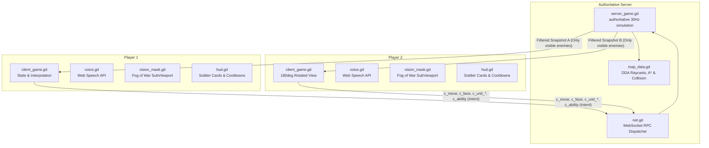

# 🎯 Tactical Squad Duel

> **Competitive Top-Down 1 vs 1 Tactical Squad Shooter for Web**  
> Built with **Godot 4.7** (GL Compatibility) · **Authoritative Dedicated Server** · **Voice-Controlled Abilities** · **Server-Side Fog of War**

[](https://github.com/ProGamerMoveHackathon/tactical-squad-duel/actions/workflows/export_web.yml)

---

## 📖 Table of Contents
1. [Game Concept & Features](#-game-concept--features)
2. [Quick Start: Run the Game in 10 Seconds](#-quick-start-run-the-game-in-10-seconds)
3. [Controls & Voice Commands](#-controls--voice-commands)
   - 🎙️ **[Full Voice Control & Hands-Free Guide (VOICE_CONTROL.md)](VOICE_CONTROL.md)**
4. [Developer Guide: How to Work on the Game](#-developer-guide-how-to-work-on-the-game)
   - [Prerequisites & Setup](#prerequisites--setup)
   - [Working in the Godot Editor](#working-in-the-godot-editor)
   - [How to Tweak Weapons, Vision & Stats](#how-to-tweak-weapons-vision--stats)
   - [How to Add or Edit Voice Phrases](#how-to-add-or-edit-voice-phrases)
   - [How the Symmetrical Map Works](#how-the-symmetrical-map-works)
   - [Automated Bot Testing (No Browser Needed)](#automated-bot-testing-no-browser-needed)
5. [Architecture & Codebase Overview](#-architecture--codebase-overview)
6. [Hosting & Deploying on the Hackathon VM](#-hosting--deploying-on-the-hackathon-vm)
7. [Troubleshooting & FAQ](#-troubleshooting--faq)

---

## 🎮 Game Concept & Features

*Tactical Squad Duel* is a 1 vs 1 competitive top-down magic duel. Each player commands four casters—**Alpha**, **Bravo**, **Charlie**, and **Delta**—but directly directs one character at a time. Arc Bolt, Volley, and Prism are their weapons.

- **Authoritative Server Simulation**: All movements, collisions, line-of-sight calculations, weapon firing, damage, and cooldowns run on the dedicated server.
- **True Anti-Cheat Fog of War**: The server uses DDA raycasts to check visibility. Hidden enemy positions are **never sent to the client** until an ally has direct line of sight. Wallhacks and client tampering cannot reveal enemies!
- **Directional Firing Cones & Auto-Shooting**: Soldiers automatically engage enemies entering their firing cone with a clear line of sight. Mechanical twitch-aim is replaced with positioning and sightline control.
- **Top-Down Tactical Mage Sprites**: Custom top-down character sprite with forward aiming wand, dynamic team tinting, health/selection arcs, and squad badges.
- **Voice-Activated Tactical Abilities**: Speak commands using your microphone (*"fog"*, *"scan"*, *"rush"*, *"outrage"*, *"flash"*, *"break magic"*, *"fireball"*, *"invisible"*) through the browser Web Speech API, with instant keyboard fallbacks (`W`, `E`, `R`).
- **Authentic ETH Zürich Polymensa Map**: Point-symmetrical competitive recreation of ETH Zürich's famous cafeteria: commercial slate kitchen, free-flow buffet counters with tray rails, dining hall with Swiss oak tables and canteen chairs, Mensa food trays, and panoramic Polyterrasse window seating. The client view automatically rotates $180^\circ$ for Player 2 so both players always defend their home base on the left side of their screen.

---

## ⚡ Quick Start: Run the Game in 10 Seconds

### The One-Command Run (Mac & Linux)
From the repository root, run:

```bash
./run_local.sh
```

**What this does automatically:**
1. Exports the web build into `build/web/` (if not already built).
2. Starts the authoritative Godot server on `ws://localhost:9080`.
3. Starts a local lightweight web server on `http://localhost:8080`.
4. Opens **two browser tabs** (one for Blue squad, one for Red squad).
5. In each tab, click **Deploy** (or press Enter) to connect and start the match!

> **Tip**: Skip rebuilding the web export on subsequent runs by passing `--no-export`:
> ```bash
> ./run_local.sh --no-export
> ```
> To stop both servers, simply press `Ctrl + C` in the terminal.

### Playing from Another PC on the Same Network

Run the LAN-compatible web build on the host:

```bash
./run_local.sh --lan
```

On the other PC, open `http://<host-ip>:8080/`, then use
`ws://<host-ip>:9080` in the Server field. Plain LAN HTTP cannot provide the
secure browser APIs used by Godot audio and microphone input, so this mode is
intentionally silent and uses keyboard/mouse controls. Use the HTTPS setup
below when browser sound or voice commands are required.

### Hosting from the Desktop Build

The native desktop lobby also has a **Host Game** button. It starts the
authoritative server on port `9080`, connects the host automatically, and stops
the server when the host leaves or closes the game. The second player joins by
entering `ws://<host-address>:9080` and pressing **Deploy**. Hosting from a web
browser is not available because browsers cannot launch a local server process.

### Playing Without Installing Godot
If you don't have Godot installed on your machine:
1. Go to the **Actions** tab on our GitHub repository.
2. Click on the latest workflow run and download the `tactical-squad-duel-web` artifact.
3. Unzip it and start the web server:
   ```bash
   python3 tools/serve_web.py 8080 /path/to/unzipped-web-folder
   ```

---

## 🕹️ Controls & Voice Commands

> 🎙️ **100% Hands-Free Playable**: The entire game can be played solely using spoken commands.  
> 👉 For the complete syntax guide, phonetic dictionary, and steering guide, read the **[Voice Control & Tactical Command Guide](VOICE_CONTROL.md)**.

| Action | Mouse / Keyboard | Spoken Voice Command | Description |
|---|---|---|---|
| **Select Soldier** | `1`, `2`, `3`, `4` (top row or numpad), `Tab`, or Click soldier | *"Alpha"*, *"Bravo"*, *"Charlie"*, *"Delta"*, *"Next"* | Directs the corresponding character; each card separately lists that character's weapon. |
| **Drive / Steer** | — | *"Alpha forward"*, *"Bravo left 30"*, *"Advance"*, *"Fall back"*, *"Turn around"* | Drives soldier along their heading or turns by degree angle. |
| **Move in Direction** | — | *"Go left"*, *"Alpha move up"*, *"North"*, *"Fall back a bit"* | Walks that way (screen-relative) until a wall. |
| **Halt / Stop** | — | *"Stop"*, *"Alpha halt"*, *"Squad hold"* | Cancels path and immediately holds position. |
| **Aim / Watch Angle** | **Right Click** or **Right-Drag** | *"Watch left"*, *"Bravo face up"*, *"Cover right"* | Rotates firing cone to cover that direction. |
| **Chained Orders** | — | *"Bravo go left and watch up"* | Several orders in one sentence; moves queue up. |
| **Spell by Slot** | `W`, `E`, `R` | *"Spell one"*, *"Ability two"*, *"Cast E"*, *"Third spell right"* | Casts the ability mapped to slot W / E / R for the active or named caster. |
| **Fog Magic** | Equipped slot (`W`/`E`/`R`) | *"Fog"*, *"Cast fog"* | Conjures vision-blocking fog a short distance ahead. |
| **Motion Scan** | Equipped slot | *"Scan"* | Emits radar pulse revealing moving enemies within 460px. |
| **Rush** | Equipped slot | *"Rush"*, *"Sprint"* | Boosts movement speed by +65% for 4s. |
| **Outrage** | Equipped slot | *"Outrage"* | Doubles casting speed and reduces incoming damage by 20% for 2s. |
| **Flash** | Equipped slot | *"Flash"* | Blinks forward in 0.1s and grants invulnerability during the blink. |
| **F*** Magic** | Equipped slot | *"Break magic"* | Toggles between a close-range empowered stick stance and a boosted wand stance. |
| **Fireball** | Equipped slot | *"Fireball"*, *"Fireball right"* | Wall-blocked circular blast with knockback and friendly fire. |
| **Invisible** | Equipped slot | *"Invisible"* | Grants 5s invisibility and +50% speed; dealing damage breaks it. |
| **Join / Rematch** | `Enter` | *"Deploy"*, *"Rematch"*, *"Play again"* | Connects from lobby or requests a post-match rematch. |
| **Toggle Microphone** | `V` or click **Mic** button | — | Starts/stops browser Web Speech recognition. |

---

## 🛠️ Developer Guide: How to Work on the Game

### Prerequisites & Setup
- **Godot Engine 4.7.x** (Standard version)
- **Web Export Templates** for Godot 4.7:
  - If you don't have them installed, run our fast downloader (downloads only the ~90 MB web templates instead of the full 1.3 GB archive):
    ```bash
    python3 tools/fetch_web_templates.py 4.7.2
    ```
- **Python 3** (used for local web hosting and template downloads)

### Working in the Godot Editor
1. Launch Godot 4 and click **Import**.
2. Select `project.godot` inside this directory and click **Import & Edit**.
3. **Renderer**: We use the **GL Compatibility** renderer for zero-friction Web export. Do not change this to Forward+ or Mobile.
4. Press **F5** to run the project directly inside Godot.

### How to Tweak Weapons, Vision & Stats
All balancing constants live in [`scripts/config.gd`](file:///Users/cyrill/hackathon-game/scripts/config.gd):

- **Weapon Stats**: Modify `WEAPONS` dictionary:
  ```gdscript
  const WEAPONS := {
      Weapon.RIFLE:   {"name": "Rifle",   "range": 400.0, "cone": 18.0, "interval": 0.60, "damage": 34, "accuracy": 0.92},
      Weapon.SMG:     {"name": "SMG",     "range": 290.0, "cone": 44.0, "interval": 0.13, "damage": 8,  "accuracy": 0.72},
      Weapon.SHOTGUN: {"name": "Shotgun", "range": 175.0, "cone": 66.0, "interval": 0.90, "damage": 10, "pellets": 6, "accuracy": 0.62},
  }
  ```
- **Vision & Fog**: Modify `VIEW_RANGE` (default 420px), `VIEW_CONE` (default 120°), and `AWARE_RADIUS` (close-range 360° awareness, default 64px).
- **Abilities**: Adjust cooldowns, durations, and effects in the `ABILITIES` dictionary.

### How to Add or Edit Voice Phrases
All voice vocabulary lives in [`scripts/config.gd`](file:///Users/cyrill/hackathon-game/scripts/config.gd): `VOICE_SUBJECTS` (who), `VOICE_DIRECTIONS`, `VOICE_STEER`, `VOICE_ACTIONS` and `VOICE_PHRASES` (abilities). Add alternative spellings or common speech recognizer mishearings, then run:
```bash
GODOT=$(bash -c 'source tools/godot_path.sh; find_godot') $GODOT --headless --path . --script res://tests/test_voice_parser.gd
```
See [VOICE_CONTROL.md](VOICE_CONTROL.md#-developer-guide) for details.

```gdscript
const VOICE_PHRASES := {
    Ability.FOG:         ["fog", "fog magic", "cast fog", "summon fog", "mist"],
    Ability.SCAN:        ["scan", "scans", "scanning", "scanner", "radar", "ping"],
    Ability.RUSH:        ["rush", "rushing", "brush", "sprint", "go go"],
    Ability.OUTRAGE:     ["outrage", "rage", "enrage", "fury"],
    Ability.FLASH:       ["flash", "blink", "flash forward"],
    Ability.BREAK_MAGIC: ["break magic", "stick mode", "wand mode"],
    Ability.FIREBALL:    ["fireball", "fire ball", "cast fireball"],
    Ability.INVISIBLE:   ["invisible", "invisibility", "vanish", "cloak"],
}
```

### How the Symmetrical Map Works
The map layout is defined in [`scripts/map_data.gd`](file:///Users/cyrill/hackathon-game/scripts/map_data.gd) via the `LEFT_HALF` ASCII array:
- `#` = solid wall / obstacle.
- `.` = walkable floor.
- The right half of the map is automatically calculated via a $180^\circ$ point rotation of the left half. This guarantees 100% mathematical symmetry.

To view or test the map grid in terminal:
```bash
godot --headless --path . --script res://tests/print_map.gd
```

### Automated Bot Testing (No Browser Needed)
Want to verify your changes without opening browsers? Run our headless automated test:

```bash
tools/bot_match.sh 30
```
This launches a headless game server, spawns two automated bot clients that engage in combat, cast abilities, and test server rule validation, then prints the match statistics.

---

## 🏗️ Architecture & Codebase Overview



### File Structure

| File | Purpose |
|---|---|
| [`scripts/config.gd`](file:///Users/cyrill/hackathon-game/scripts/config.gd) | Central constants: weapons, vision angles, cooldowns, voice dictionary. |
| [`scripts/map_data.gd`](file:///Users/cyrill/hackathon-game/scripts/map_data.gd) | Symmetrical map grid, fast DDA line-of-sight raycasting, fog clipping, A* pathfinding. |
| [`scripts/net.gd`](file:///Users/cyrill/hackathon-game/scripts/net.gd) | Autoload network node (`Net`). Manages WebSocket connections and RPC calls. |
| [`scripts/main.gd`](file:///Users/cyrill/hackathon-game/scripts/main.gd) | Game entry point: auto-selects Server mode if headless/`--server`, else Client mode. |
| [`scripts/server/server_game.gd`](file:///Users/cyrill/hackathon-game/scripts/server/server_game.gd) | Authoritative simulation: movement, collision resolution, weapon firing, Fog of War snapshot filtering. |
| [`scripts/client/client_game.gd`](file:///Users/cyrill/hackathon-game/scripts/client/client_game.gd) | Client logic: input handling, snapshot interpolation, sound dispatch, screen rotation. |
| [`scripts/client/map_view.gd`](file:///Users/cyrill/hackathon-game/scripts/client/map_view.gd) | Renders ETH Polymensa tiles: kitchen slate, buffets, dining tables, chairs, Mensa trays, terrace seating. |
| [`scripts/client/vision_mask.gd`](file:///Users/cyrill/hackathon-game/scripts/client/vision_mask.gd) | Generates the dynamic visual fog-of-war mask polygon inside a SubViewport. |
| [`scripts/client/entity_view.gd`](file:///Users/cyrill/hackathon-game/scripts/client/entity_view.gd) | Renders soldiers, weapon cones, magic tracers, damage indicators, and fog. |
| [`scripts/client/hud.gd`](file:///Users/cyrill/hackathon-game/scripts/client/hud.gd) | Renders bottom squad cards, ability bars, voice status indicator, and match banners. |
| [`scripts/client/voice.gd`](file:///Users/cyrill/hackathon-game/scripts/client/voice.gd) | Web Speech API bridge to Godot via `JavaScriptBridge`. |
| [`scripts/client/sfx.gd`](file:///Users/cyrill/hackathon-game/scripts/client/sfx.gd) | Zero-asset procedural audio generator (gunshots, hits, abilities, voice pings). |
| [`deploy/`](file:///Users/cyrill/hackathon-game/deploy/) | VM deployment configs (`tactical-squad-duel.service` & `Caddyfile`). |
| [`tools/`](file:///Users/cyrill/hackathon-game/tools/) | Shell scripts and Python utilities for running, testing, and serving the game. |

---

## ☁️ Hosting & Deploying on the Hackathon VM

The game includes ready-to-use production configs in [`deploy/`](file:///Users/cyrill/hackathon-game/deploy/):

### 1. Install Godot on the VM
```bash
# Example for Ubuntu/Debian x86_64:
curl -sSL "https://github.com/godotengine/godot/releases/download/4.7.2-stable/Godot_v4.7.2-stable_linux.x86_64.zip" -o /tmp/godot.zip
sudo unzip /tmp/godot.zip -d /usr/local/bin/
sudo mv /usr/local/bin/Godot_v4.7.2-stable_linux.x86_64 /usr/local/bin/godot
```

### 2. Clone Repository & Setup Systemd Service
```bash
sudo git clone https://github.com/ProGamerMoveHackathon/tactical-squad-duel.git /opt/tactical-squad-duel
cd /opt/tactical-squad-duel

# Enable the dedicated game server as a background service:
sudo cp deploy/tactical-squad-duel.service /etc/systemd/system/
sudo systemctl daemon-reload
sudo systemctl enable --now tactical-squad-duel
```

### 3. Setup Caddy for HTTPS & WebSockets
Browsers **only permit microphone access over HTTPS or localhost**. [Caddy](https://caddyserver.com/) automatically manages SSL certificates:

```bash
sudo apt install -y caddy
sudo cp deploy/Caddyfile /etc/caddy/Caddyfile
# Edit /etc/caddy/Caddyfile to replace 'game.example.com' with your domain or public IP
sudo systemctl reload caddy
```

Now anyone can open `https://your-domain.com/` in their browser and duel!

---

## ❓ Troubleshooting & FAQ

- **Microphone / Voice commands not working?**
  - Web Speech API requires a **secure context**: it only functions on `localhost` or via `https://`. It will not work over plain `http://<remote-ip>`.
  - Use Chrome or Edge for the best speech recognition support (Safari has limited support; Firefox currently lacks Web Speech API and should use keyboard shortcuts `Q`, `E`, `R`, `F`).
- **"Port 9080 already in use" error?**
  - Kill any orphaned local servers:
    ```bash
    pkill -f "hackathon-game"
    ```
- **Exporting the web build fails?**
  - Make sure the web templates are installed:
    ```bash
    python3 tools/fetch_web_templates.py 4.7.2
    ```
